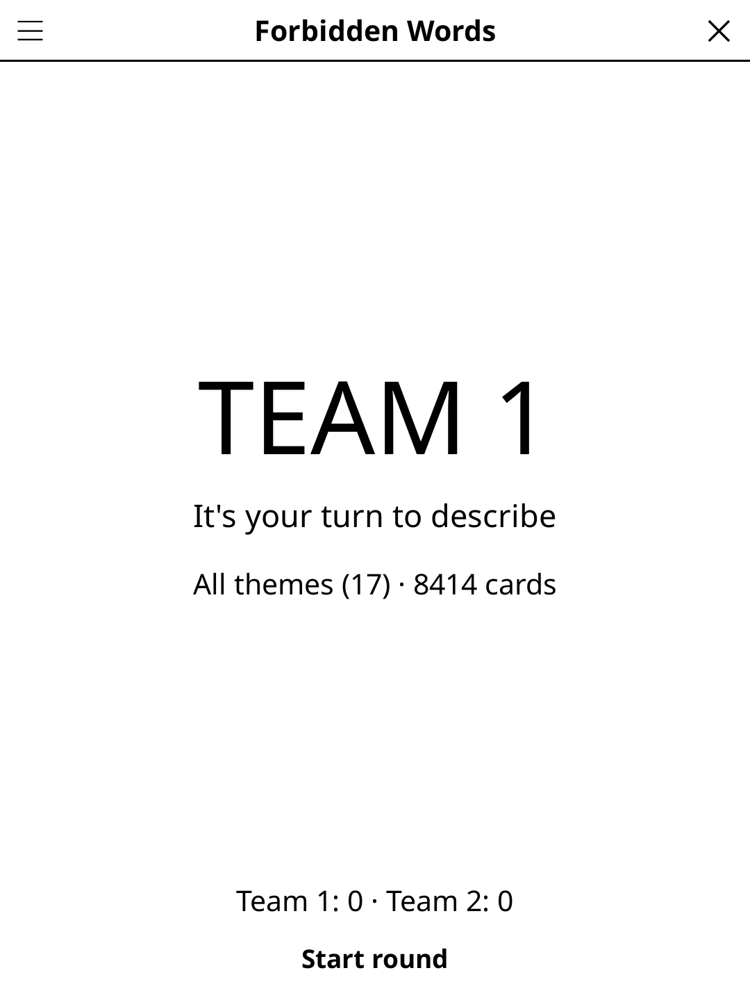

# taboo.koplugin

A **Forbidden Words** (FR « Mots interdits ») display plugin for [KOReader](https://github.com/koreader/koreader) — describe the word to your team without saying any of its forbidden words, around the table with your own card deck.

## Screenshot



## Concept

Teams take turns. The active player picks up the device and describes as many words as possible before the timer runs out — without saying any of the forbidden words listed below the main word. Opponents watch for slip-ups and can buzz. Correct guesses score +1, buzzes score −1.

Two decks are built in — 8,402 French cards and 2,545 English ones — and you can add your own from a JSON file in KOReader's documents folder.

## Rules

- Teams take turns. The active player describes words without saying any of the forbidden words listed on the card.
- **✓ +1** — teammates guessed correctly.
- **✗ Buzzed** — an opponent called out a forbidden word → −1 for the active team.
- **→ Skip** — pass the card, no penalty.
- Play until the timer runs out or the agreed card count is reached; then teams swap.

## Features

- **Card display** — main word large, forbidden words clearly listed below
- **Countdown timer** — 30 s to 2 min per round (configurable)
- **Live scoring** — ✓ +1 / ✗ −1 / → Skip, applied instantly; round delta shown at timer end
- **Auto team rotation** — advances to the next team after each round
- **2–6 teams** — configurable team count
- **Two bundled decks** — 8,402 French cards across 17 themes, and 2,545 English cards across 20 themes (written for English speakers, not translated: Sherlock Holmes, Big Ben, Fish and chips, Muhammad Ali…) — nothing to set up
- **Deck language** — Options → Language picks the French or the English deck; until you choose, it follows KOReader's language (French → French deck, anything else → English). The theme filter shows the deck's own theme names
- **E-ink friendly** — only the timer digit refreshes in fast/A2 mode

## Card JSON format

Both decks are built in, so this is only needed to add your own cards or to
replace a deck.

Create a file named `taboo_cards_fr.json` (or `taboo_cards_en.json`, or `taboo_cards.json`) and copy it to KOReader's **documents** folder (`/sdcard/koreader/` on most devices).

```json
[
  {
    "word": "Éléphant",
    "forbidden": ["Afrique", "Trompe", "Gris", "Barrissements", "Zoo"]
  },
  {
    "word": "Pizza",
    "forbidden": ["Italie", "Fromage", "Four", "Pâte", "Napoli"]
  }
]
```

Each card object must have:
- `"word"` — the word to describe
- `"forbidden"` — array of words that cannot be said

Cards are shuffled, and the ones played in earlier sessions (the last 3,000, remembered per deck language, also for your own deck) go last; once every card of the chosen themes has been played, a new cycle starts.

## Controls

| Button | Action |
|--------|--------|
| **Commencer la manche / Start round** | Start the timer for the active team |
| **✓ +1 Trouvé / ✓ +1 Got it** | Guessed — +1 to round tally, next card |
| **✗ −1 Grillé / ✗ −1 Buzzed** | Buzzed — −1 to round tally, next card |
| **→ Passer / → Skip** | Skip card, no penalty |
| **■ Fin de manche / ■ End round** | Stop early and apply round score |
| **Options** | Language, teams, timer duration, reset |
| **Rules** | Show rules reminder |
| **Close** | Exit |

## Installation

### Via KOReader Plugin Manager

```
taboo.koplugin/ → KOReader plugins/ folder
game-common/     → alongside plugins/ (shared library)
```

### Manual

1. Download `taboo.zip` from [Releases](../../releases).
2. Extract to your KOReader `plugins/` directory.
3. Optional: copy your own `taboo_cards_fr.json` (or `taboo_cards_en.json`) to KOReader's documents folder.
4. Restart KOReader — **Forbidden Words** appears under Tools → Games → Party & quiz.

## Development

`taboo.koplugin/` lives inside the
[koreader-plugins](https://github.com/t2ym5u/koreader-plugins) monorepo.

`taboo_cards_fr.lua` is the bundled deck. It is **generated** — do not edit it
by hand, the next build would overwrite the change. The sources are
`gen/cards_*.json`; `gen/merge.py` concatenates them into `taboo_cards_fr.json`
(dropping cards whose word is already taken), and `gen/to_lua.py` converts that
into the Lua file the plugin loads:

```
python3 gen/merge.py && python3 gen/to_lua.py
```

The English deck has its own sources, one pipe-separated file per theme in
`gen/en/` (`Word|forbidden1|…|forbidden5|easy|medium|hard`); `gen/build_en.py`
checks them (five distinct forbidden words, none part of the guess word, no
duplicate across the deck, a family-friendly blocklist) and writes
`taboo_cards_en.lua`:

```
python3 gen/build_en.py
```

`test_cards_spec.lua` reads both generated decks and checks every card;
`test_family_spec.lua` checks both against a blocklist.

## License

GPL-3.0
